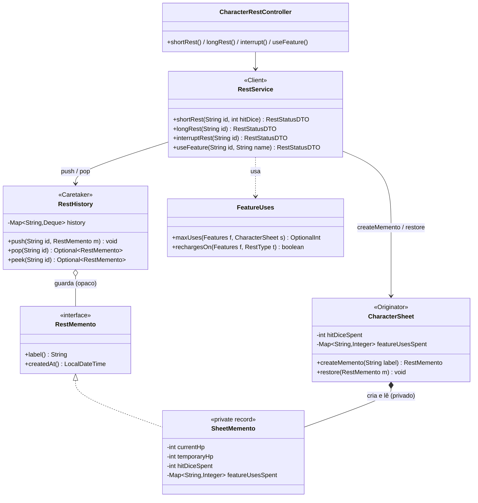

# Padrão Memento — Descanso curto/longo com restauração

Este documento explica como o padrão **Memento** foi aplicado ao sistema de
**descansos** da ficha de personagem (descanso curto, descanso longo e
"interromper descanso").

---

## 1. Problema que o padrão resolve

Um descanso altera várias coisas ao mesmo tempo: HP atual, HP temporário,
dados de vida gastos e usos de features (Rage, Second Wind, Action Surge...).
Na regra do jogo, um descanso **interrompido** (uma emboscada, por exemplo)
não dá benefício nenhum — a ficha precisa voltar **exatamente** ao que era
antes dele.

Sem Memento, a alternativa seria cada regra de descanso lembrar o que mudou
(como o `Command` faz com `previousCurrentHp`) ou a ficha expor todos os seus
campos para alguém copiar. O Memento resolve isso:

- guarda um **snapshot** do estado antes do descanso;
- **sem quebrar o encapsulamento**: quem guarda o snapshot não consegue ler
  nem alterar o conteúdo;
- restaura tudo de uma vez, com **uma única** notificação aos observers
  (um único auto-save).

---

## 2. Estrutura implementada

```
memento/
├── RestMemento.java        (interface estreita: só label() e createdAt())
└── RestHistory.java        (Caretaker: pilha de mementos por personagem)

model/character/
└── CharacterSheet.java     (Originator: createMemento() / restore();
                             contém o record privado SheetMemento)

rest/
├── RestService.java        (Client: orquestra o descanso)
├── RestType.java           (SHORT / LONG)
└── FeatureUses.java        (máximo de usos e tipo de recarga das features)

controller/
└── CharacterRestController.java   (endpoints REST)
```

### Papéis do padrão no projeto

| Papel clássico do GoF | Classe no projeto |
|------------------------|-------------------|
| `Memento` (interface estreita) | `RestMemento` |
| `Memento` (conteúdo) | `CharacterSheet.SheetMemento` (record **privado**) |
| `Originator` | `CharacterSheet` |
| `Caretaker` | `RestHistory` |
| `Client` | `RestService` |

### Diagrama de classes




---

## 3. Preservando o encapsulamento

O ponto central do Memento é que o **Caretaker não enxerga o estado**. Em
Java isso é feito com duas "faces" do memento:

```java
// Face pública: o que o resto da aplicação enxerga
public interface RestMemento {
    String label();
    LocalDateTime createdAt();
}

// Face privada: só a CharacterSheet conhece e lê o conteúdo
private record SheetMemento(
        String label, LocalDateTime createdAt,
        int currentHp, int temporaryHp,
        int hitDiceSpent, Map<String, Integer> featureUsesSpent
) implements RestMemento { ... }
```

`RestHistory` e `RestService` só manipulam `RestMemento`. Se alguém tentar
restaurar a ficha com um memento que ela não criou, `restore()` lança
`IllegalArgumentException`. O record também faz **cópia defensiva** do mapa
de usos (`Map.copyOf`), então o snapshot não muda quando a ficha muda depois.

---

## 4. O Originator: `CharacterSheet`

```java
public RestMemento createMemento(String label) {
    return new SheetMemento(label, LocalDateTime.now(),
            currentHp, temporaryHp, hitDiceSpent, featureUsesSpent);
}

public void restore(RestMemento memento) {
    if (!(memento instanceof SheetMemento snapshot)) {
        throw new IllegalArgumentException("Memento não foi criado por uma CharacterSheet.");
    }
    updateBatch(() -> {
        setCurrentHp(snapshot.currentHp());
        setTemporaryHp(snapshot.temporaryHp());
        setHitDiceSpent(snapshot.hitDiceSpent());
        setFeatureUsesSpent(snapshot.featureUsesSpent());
    });
}
```

O `updateBatch` (já existente no projeto) agrupa as quatro alterações em uma
única notificação aos observers.

Dois campos novos foram adicionados à ficha e são **persistidos no JSON**:
`hitDiceSpent` e `featureUsesSpent`. Fichas salvas antes desta mudança
continuam carregando normalmente (os campos assumem o valor padrão).

---

## 5. O Caretaker: `RestHistory`

Guarda os snapshots **por personagem**, em uma pilha limitada a 5 itens
(o mais antigo é descartado). Só empilha, desempilha e consulta — nunca abre
o memento.

Assim como o histórico do `CharacterCommandInvoker`, fica **em memória**: a
ficha é recarregada do disco a cada requisição, então o snapshot precisa
viver fora da instância de `CharacterSheet`.

---

## 6. Fluxo de um descanso

```
POST /api/characters/{id}/rest/long
        │
        ▼
RestService.longRest(id)
   1. sheet = characterService.getById(id)
   2. memento = sheet.createMemento("Antes do descanso longo")
   3. restHistory.push(id, memento)          ← Caretaker guarda
   4. aplica as regras do descanso
   5. characterService.save(sheet)

POST /api/characters/{id}/rest/interrupt
        │
        ▼
RestService.interruptRest(id)
   1. memento = restHistory.pop(id)          ← Caretaker devolve
   2. sheet.restore(memento)                 ← Originator se restaura
   3. characterService.save(sheet)
```

### Regras dos descansos

| | Descanso curto | Descanso longo |
|---|---|---|
| HP | Gasta N dados de vida; cada um cura `dado/2 + 1 + mod. CON` (média, sem rolagem) | Vai ao máximo |
| HP temporário | Mantém | Zera |
| Dados de vida | N gastos (limitado ao que resta; total = nível) | Recupera metade do nível (mínimo 1) |
| Features | Recarrega as de `shortRest` | Recarrega as de `shortRest` e `longRest` |

O valor médio dos dados foi escolhido para que o resultado seja
**reproduzível** e testável. Os dados de recarga e de usos vêm dos próprios
JSONs de classe (`usage.recharge`, `usage.uses`, `usage.usesByLevel`);
`uses` aceita número, `proficiency_bonus` e `charisma_modifier`.

---

## 7. Endpoints

| Método | Rota | Descrição |
|--------|------|-----------|
| `GET`  | `/api/characters/{id}/rest` | Estado de descanso (dados de vida, usos de features, se há o que interromper) |
| `POST` | `/api/characters/{id}/rest/short?hitDice=N` | Descanso curto gastando N dados de vida |
| `POST` | `/api/characters/{id}/rest/long` | Descanso longo |
| `POST` | `/api/characters/{id}/rest/interrupt` | Restaura a ficha ao estado anterior ao último descanso (`409` se não houver) |
| `POST` | `/api/characters/{id}/features/use?name=X` | Gasta um uso de uma feature (`409` se não restar nenhum) |

Na tela da ficha, o painel "⚔ Ações de Combate" ganhou a seção **Descanso**,
com os botões de descanso curto, longo e interromper, e a lista de features
com usos (●○) e o botão **Usar**.

---

## 8. Decisões de design e limitações

- **Interação com o Command:** cada descanso limpa o histórico de undo do
  `CharacterCommandInvoker` daquele personagem. Desfazer um dano antigo depois
  de um descanso restauraria um HP que já não faz sentido.
- **Interromper desfaz o descanso inteiro, não só o descanso:** o memento
  guarda HP, HP temporário, dados de vida e usos de features. Se o usuário
  mudou algum desses campos *depois* do descanso (tomou dano, usou Rage),
  "interromper" os sobrescreve com o estado de antes do descanso.
- **Histórico em memória:** reiniciar o servidor apaga os mementos (o JSON da
  ficha, com o estado atual, é mantido). Persistir os snapshots em disco seria
  uma evolução natural (ex.: `saves/mementos/{id}/`).
- **O que o memento não cobre:** nome, nível, atributos, equipamento e notas.
  O snapshot guarda só o que um descanso pode alterar.
